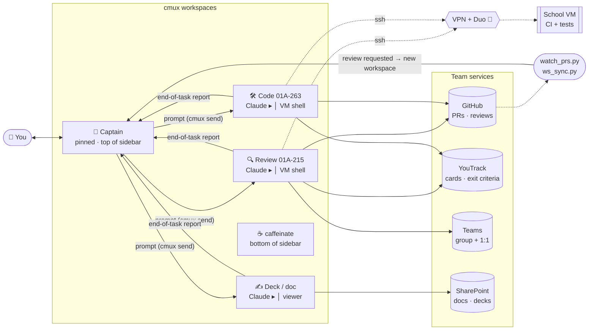

<h1 align="center">captain</h1>
<p align="center">
  
  
  
  
</p>

<h3 align="center">Talk to one agent. Run the whole capstone.</h3>

<p align="center">
  
</p>

## What it is

A capstone team juggles a lot at once: YouTrack cards, PRs waiting for review, CI on a school VM behind a VPN, Teams messages, SharePoint documents, weekly decks. Run one coding agent per task and you end up switching between tabs and copying context from one to the next.

Captain flips that. You talk to one agent, the **Captain**, pinned at the top of your cmux sidebar. It opens one workspace per card or review (a Claude session on the left, a VM shell on the right), sends each one its prompt, watches them finish, and keeps YouTrack, GitHub and Teams in sync. It reports back in a fixed format so you can read any workspace the same way.

Captain is not an app. It's a Claude Code skill, a set of scripts, and the conventions Team Aurora (GMU DAEN-690, Fall 2026) used day to day: naming, review rules, comment formats and posting order. Fork it, fill in one config file, and type `/captain`.

> Inspired by [kunchenguid/firstmate](https://github.com/kunchenguid/firstmate), the "talk to one agent, ship with a crew" protocol. Captain adapts the idea, and its first-run tool check, for a school capstone.

## How it works



## Features

- **One liaison.** You talk only to Captain. It opens workspaces, sends prompts, reads their screens and reports: what needs work now, what's waiting and on whom, your YouTrack cards, your PRs and review requests.
- **A visible crew.** Every task runs in its own cmux workspace you can watch or type into. Captain is pinned at the top, ☕ caffeinate at the bottom.
- **Automatic reviews.** When your GitHub account is requested as reviewer, a review workspace opens. It checks every exit criterion against evidence, runs tests locally and on the VM, posts a formal GitHub review, ticks the card and comments on YouTrack, then sends the Teams line.
- **First-run setup check.** `/captain` checks for missing tools, GitHub and YouTrack access, the Microsoft login and the VPN. It explains what each is for and installs only what you approve.
- **House rules included.** Naming, branch and PR format, link-first YouTrack comments, Teams message formats, deck and document flow, SharePoint uploads.
- **Restart-proof.** State lives in `CAPTAIN.md` and per-task `STATE.md` hand-offs, so `/clear` + `/captain` (or `task_open.sh`) picks up where you left off.
- **Hands-off VPN.** `vm_ensure.sh` connects the Cisco VPN and can approve the Duo push through iPhone Mirroring, with a manual path for Android.

## Contents

| Path | What it is |
|---|---|
| `skill/captain/SKILL.md` | The `/captain` Claude Code skill. Boilerplate rules first, then a **CUSTOMIZE** section with your own rules |
| `skill/captain/scripts/` | Layout, status, VPN/VM, PR watcher and workspace sync scripts |
| `scripts/` | Markdown → PDF/DOCX, markdown viewer, YouTrack poller |
| `scripts/pw/` | Playwright scripts for Teams (group and 1:1 messages) and SharePoint (upload, download, list); `ms-login.mjs` for the one-time Microsoft sign-in |
| `skill/captain/scripts/bootstrap.sh` | First-run check: missing tools, GitHub and YouTrack access, Microsoft login, VPN. `bootstrap.sh install <tools>` installs the approved ones |
| `templates/` | `CLAUDE.md` project template, YouTrack comment, task and user-story formats |
| `docs/` | One page per topic (list below) |
| `config/captain.env.example` | Every value you need to change, in one file |
| `install.sh` | Copies the skill into `~/.claude/skills/captain` and fills in your values |

Docs:

1. [Tech stack and models](docs/tech-stack.md): cmux, Claude Code, Codex/Astra, which model does what
2. [Workspace layout](docs/workspace-layout.md): Captain pinned at the top, ☕ caffeinate at the bottom, one workspace per task
3. [Naming conventions](docs/naming-conventions.md): workspaces, branches, PRs, files
4. [Review pipeline](docs/reviews.md): how a PR review runs end to end
5. [GitHub setup](docs/github.md)
6. [YouTrack setup](docs/youtrack.md)
7. [Teams messages](docs/teams.md): group chat and personal 1:1 formats
8. [Documents, decks and SharePoint](docs/documents-decks-sharepoint.md)
9. [VPN, Duo and phone setup](docs/vpn-phone.md): iPhone and Android
10. [Known pains](docs/pains.md)

---

## Requirements

### CLIs to install

| Tool | Install (macOS) | Used for | Required? |
|---|---|---|---|
| **Claude Code** (`claude`) | `npm i -g @anthropic-ai/claude-code` | Captain and every task session | Yes |
| **cmux** | https://cmux.dev (app, includes `cmux` CLI) | Workspaces, split panes, sending prompts to sessions, PR badges | Yes |
| **GitHub CLI** (`gh`) | `brew install gh` | PRs, reviews, reviewer requests, CI status | Yes |
| **git** | `xcode-select --install` | Worktrees, one per task | Yes |
| **Python 3.11+** | `brew install python` | `setup.py`, `status.py`, watchers | Yes |
| **Node 20+** (with npm) | `brew install node` | Runs the Teams/SharePoint scripts | Yes, for Teams/SharePoint |
| **Playwright** (npm package) | `cd <project>/scripts/pw && npm install && npx playwright install chromium` (`install.sh` does this) | Drives the browser for Teams messages and SharePoint upload/download/list. Installed **next to the scripts**, not with `-g`, because the scripts `import 'playwright'` and Node won't find a global copy | Yes, for Teams/SharePoint |
| **Google Chrome** | `brew install --cask google-chrome` | The scripts launch real Chrome (`channel: 'chrome'`) with the saved Microsoft login; `md2pdf.sh` prints PDFs with it | Yes, for Teams/SharePoint/PDFs |
| **Codex CLI** (`codex`) | `npm i -g @openai/codex` | Astra second-opinion reviews, the Duo-approval helper | Optional |
| **glow** | `brew install glow` | Showing markdown in a side pane | Optional |
| **Cisco Secure Client** | From your school's IT portal | VPN to the school VM | If your CI/VM is behind VPN |
| **Duo Mobile** | App Store / Play Store | VPN two-factor push | If your school uses Duo |
| `caffeinate` | Built into macOS | Keeps the Mac awake while sessions run | Built in |

### Python / Node packages

- Python: standard library only for the Captain scripts and `docx2md.py`. `md2pdf.sh` needs `markdown` (`python3 -m pip install --user markdown`).
- Node: `playwright`, pinned in `scripts/pw/package.json`.
- No Microsoft CLI or API key is needed for Teams or SharePoint. The scripts use your normal school login, saved once with `node scripts/pw/ms-login.mjs` (Duo on your phone) in `~/.local/share/capstone/pw-profile`. It expires every few weeks; run it again when a script says you're logged out.

### Accounts and access

- A GitHub account for school work only (keep it separate from your personal account), added to the team repo.
- A YouTrack permanent token (Profile → Account Security → New token).
- A Microsoft 365 school login for Teams and SharePoint (you log in once in the Playwright browser profile).
- SSH key access to the team VM, if you run tests there.

---

## Quick Start

```bash
gh repo clone <you>/captain && cd captain
cp config/captain.env.example config/captain.env   # fill in your values
./install.sh                                      # installs ~/.claude/skills/captain
cp templates/CLAUDE.md.template "$PROJECT_DIR/CLAUDE.md"   # then edit it
```

1. Open cmux, start a workspace in your project folder, run `claude`.
2. Type `/captain`. The first thing it does is run `bootstrap.sh`. If anything is missing, Captain introduces itself, lists the missing tools (with what each is for and the install command), and asks for your YouTrack token (for your cards and task numbers) and your GitHub login (for your open PRs and review requests). It installs only the tools you approve. Logins and tokens you enter yourself with `!` commands, never in chat. This check is modeled on firstmate's `fm-bootstrap.sh` ([kunchenguid/firstmate](https://github.com/kunchenguid/firstmate)).
3. Once the check passes, it pins the Captain workspace at the top, puts a ☕ caffeinate workspace at the bottom, logs task workspaces into the VM, and reports your cards, PRs and review requests.
4. Ask Captain to start a task or review. It opens a new workspace for it and sends the prompt.

Secrets (`.env`, tokens, VPN passwords) never go in this repo. `config/captain.env` is git-ignored.

---

## Customizing

Everything personal is either in `config/captain.env` or marked `CUSTOMIZE` in `skill/captain/SKILL.md` and `templates/CLAUDE.md.template`. The boilerplate rules (one workspace per task, never post without approval, link-first comments, and so on) are meant to work for any team. Change the rest to fit yours: your tracker, your chat, your naming, your models.
