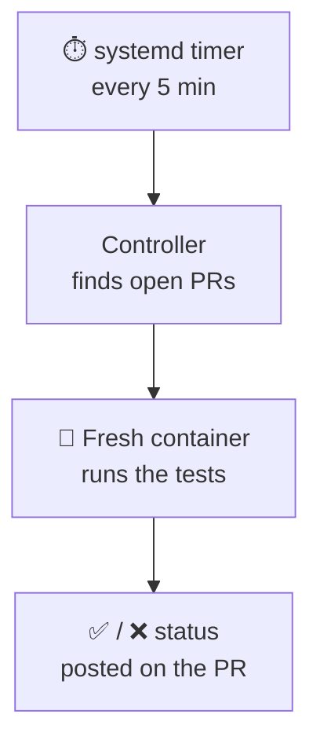

# CI on a school VM

Our team's GitHub organization had GitHub Actions turned off, so we ran our own CI on a school VM. The code lives in the team repository (`scripts/ci/`), not here. This page explains how it works so you can build your own.

## How it works

1. **Timer.** `team-aurora-ci.timer` starts the controller 2 minutes after boot, then 5 minutes after each run finishes.
2. **Controller.** Lists open PRs and fetches each new head commit into a fresh bare clone. It verifies the exact commit SHA, then exports the source without `.git`.
3. **Container.** Every job runs in a new, throwaway Docker container:
   - non-root user, all capabilities dropped, no privilege escalation;
   - no network: dependencies come from a reviewed offline wheel bundle with `--require-hashes`;
   - no host folders mounted, and a time limit.
4. **Checks.** Lint (fatal errors) and Black formatting, unit tests (`tests/unit`), then the MCP tests (`tests/mcp`) in a separate locked environment.
5. **Status.** Posts a GitHub commit status named `team-aurora/local-ci` (success, failure or error) on the PR's head commit. Test output stays in private logs on the VM; it is never posted to the PR.

## Rules that kept it safe

- **PR code never changes the CI.** The controller lives in a root-owned folder (`/opt/team-aurora-ci`), a symlink to a versioned release. Committing CI changes doesn't deploy them; a person reviews, tests and installs them atomically.
- **New dependencies need a person.** A PR can't download packages. When it adds one, someone reviews the lock, checks the hashes against PyPI, and rebuilds the offline bundle.
- **Credentials** sit in one root-only env file on the VM. They are passed only to the GitHub API calls and a Git askpass helper, never to the test container.
- **One host at a time.** When CI moved from a Windows PC (WSL) to the school VM on 25 Sep 2026, the old timer was disabled and kept only for rollback. Two runners would post conflicting statuses.

## Operating it

| Task | Command (on the VM) |
|---|---|
| Is it running? | `systemctl list-timers team-aurora-ci.timer` |
| Recent runs | `sudo journalctl -u team-aurora-ci -n 30 --no-pager` |
| Health record | `sudo cat /var/lib/team-aurora-ci/heartbeat.json` |
| Deploy a reviewed change | pause the timer → wait for the running job → build the image → run the CI regression tests → `install.sh` → start the timer |
| Roll back | stop the timer, select the previous validated release and image ID |

Logs are capped at 1 MiB per job, and the last 200 are kept.

## Problems we hit

| Problem | Cause | Fix |
|---|---|---|
| "No space left on device" (PR #157) | The 768 MB `/work` tmpfs filled during the MCP venv install | Made the tmpfs bigger and kept large evidence files out of PRs |
| "No space left on device" (PR #173) | pytest kept every test's temp folder on the container's 128 MB `/tmp` | `pytest.ini` keeps temp folders only for failed tests. The first guess (a 6.8 MB data file) was wrong |
| Dependency setup error | PR added a package missing from the offline bundle | Review the lock, rebuild the bundle (`ci_lock_update.sh` automates the safe "adds only" case) |
| `ImportError: libexpat.so.1` | Rasterio wheel needed a system library | Added `libexpat1` to the image |
| CI unreachable from home | The VM needs the school VPN | `vm_ensure.sh` (see [VPN and phone](vpn-phone.md)) |

## Build your own

You need a Linux host with Docker and systemd, a GitHub token that can post commit statuses, and an offline wheel bundle for your requirements. If your organization allows GitHub Actions, use that instead. This setup only exists because ours didn't.
